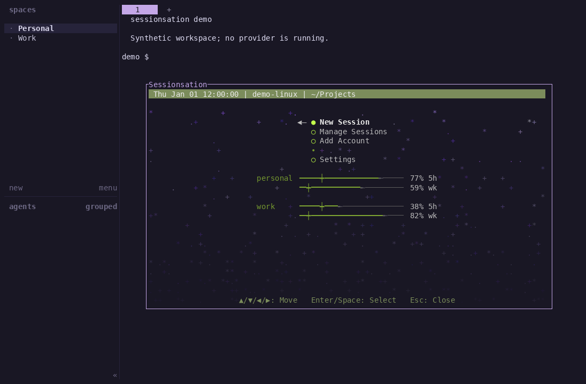

# sessionsation-ui

An animated terminal popup for [sessionsation](https://github.com/anastaci1a/sessionsation)
inside [HERDR](https://herdr.dev). Choose an account, Space, name and directory;
start in a normal tab; manage accounts, saved sessions and background operations, including a
per-session **Auto start** mode (Disabled, Start, or Start/Prompt with an editable prompt; contract 1.43+,
[usage](docs/usage.md)).
The CLI owns credentials and lifecycle. Closing the popup leaves agents running.

**Early development.** Codex, Claude Code, Gemini CLI and Antigravity CLI are supported
through a compatible sessionsation backend (tested against contract 1.43.0); each session
and account offers only what the backend capabilities allow. Some lifecycle/experimental
actions remain unavailable;
[capabilities and limits](docs/usage.md#capabilities-and-limits) describe what actually works.



Synthetic personal/work accounts and an inert shell; no provider calls.
[Regenerate and review the demo](docs/verification.md#animated-demo).

## Requirements and install

Linux, HERDR **0.9.5** (the tested version), a configured sessionsation CLI speaking
public API v1 with contract MAJOR 1 and MINOR 17 or newer (the popup refuses an older or
different-MAJOR backend at start), Git, a C toolchain and rustup. Node.js **22.18+** runs the optional
configuration installer and compatibility tools. The pinned Rust toolchain is
1.95.0; the package declares a 1.88 minimum, which is not independently verified.

```sh
git clone https://github.com/anastaci1a/sessionsation-ui.git
cd sessionsation-ui
CARGO_TARGET_DIR=target-ui cargo build --release --locked
mkdir -p .runtime
install -m 755 target-ui/release/sessionsation-ui .runtime/sessionsation-ui
herdr plugin link "$PWD" --enabled
```

The repository is public; cloning and building do not require GitHub authentication.
The popup uses the backend at `/mnt/user/live/packages/sessionsation/current/sessionsation`
by default: it follows the `current` symlink on every call instead of pinning a release,
so a backend update needs no UI change. `SESSIONSATION_BIN` or the `binary` key of
`.runtime/config.json` overrides it ([details](docs/usage.md#install-and-configure)).
Keep the checkout/plugin and executable available. These steps do not configure
provider accounts or automatically change your terminal startup.

### Update

```sh
git pull --ff-only
CARGO_TARGET_DIR=target-ui cargo build --release --locked
install -m 755 target-ui/release/sessionsation-ui .runtime/sessionsation-ui
```

Open popups keep running the old binary; new ones use the installed one. Backend updates
are separate and need no rebuild.

## Quick start

First [configure the backend path, data root and your own keybinding](docs/usage.md#install-and-configure).
Inside that HERDR instance:

```sh
./bin/sessionsation-popup open
```

Choose New Session, fill its fields, then Start Session. New directories are staged
until Start, including the directory picker's Create action. The popup exits after
successful handoff to a normal tab. Resume retains the provider conversation; it
is not a cross-provider conversion or automatic migration of existing agents.

For a credential-free preview, see the [isolated demo](docs/verification.md#animated-demo).

## Development and tests

```sh
scripts/check-rust.sh   # cargo fmt --check, clippy -D warnings, cargo test (locked)
npm test                # Node tests (node --test)
npm run check           # JS/Bash syntax, manifest fields, local Markdown links
```

Without local toolchains, build `scripts/Dockerfile.check` and run the same commands in
it; the [contributor guide](agents/README.md) has the recipe. Docs-only changes need
`npm run check`. Optional PTY/HERDR scripts and the demo (`scripts/Dockerfile.demo`) are in
[verification](docs/verification.md).

## Documentation

See [usage/configuration](docs/usage.md), [architecture](docs/architecture.md),
[checks/demo regeneration](docs/verification.md), and [contributing](agents/README.md).
MIT licensed; [NOTICE](NOTICE) records upstream palette/reference attribution and
unresolved reference-license provenance; public visibility does not resolve it.

## Release procedure

1. Build from a clean checkout of the commit (never a `git archive` copy) into a **fresh, empty
   target dir**: `SESSIONSATION_COMMIT=$(git rev-parse HEAD) CARGO_TARGET_DIR=$(mktemp -d) cargo build --release --locked`.
   A reused target dir with copied sources can keep stale artifacts (cdebfee shipped without
   `claude_spinner` that way).
2. Run `scripts/check-rust.sh`; the binary's `--version` must print the release sha.
3. Install to `releases/<sha>`, write `deployments/<ts>/`, switch `.runtime/sessionsation-ui`, then run
   `scripts/smoke-installed.sh <installed binary> <sha>`. Failure means: switch the link back to
   the previous release immediately (`rollback-note.txt`).
