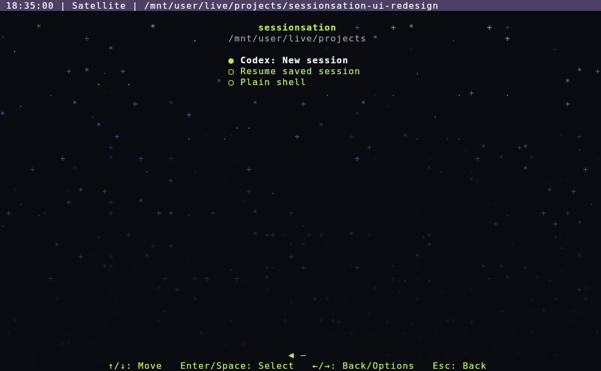

# sessionsation-ui

A terminal launcher and thin HERDR management viewer for
[sessionsation](https://github.com/anastaci1a/sessionsation). Account, credential and
agent lifecycle decisions belong to the backend. Detaching a viewer leaves agents
running.

Requires Node.js 22.18+, Bash, coreutils `readlink`, HERDR 0.9.5+ and a separately verified sessionsation
CLI with public API v1. Claude remains preparation-only in the backend.

```sh
export SESSIONSATION_BIN=/absolute/path/to/sessionsation
export SESSIONSATION_DATA_DIR=/explicit/backend/data-root
./bin/sessionsation-ui launcher
./bin/sessionsation-ui manage
```

The launcher offers new sessions, saved-session resume and a plain shell. Interactive
terminals get cycling colors, stars, a shimmer sweep and a directory picker, with
controls at the terminal bottom. Use arrows and Enter/Space; Esc goes back.
Management remains a separate command.



The separate management viewer provides account/usage inspection and backend-driven operations.
HERDR integration and future-terminal configuration are documented in
[usage](docs/usage.md). See [documentation](docs/README.md) and
[contributor instructions](agents/README.md).
