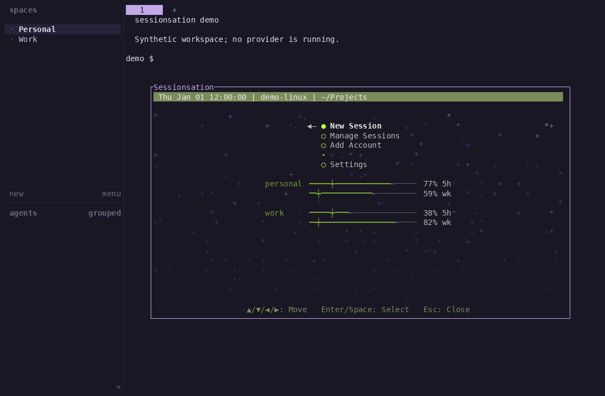

# sessionsation-ui

An animated terminal popup for [sessionsation](https://github.com/anastaci1a/sessionsation)
inside [HERDR](https://herdr.dev). Choose an account, Space, name and directory;
start in a normal tab; manage accounts, saved sessions and background operations.
The CLI owns credentials and lifecycle. Closing the popup leaves agents running.

**Early development.** Codex is supported through a compatible sessionsation backend.
Claude is preparation-only. Some lifecycle/experimental actions remain unavailable;
[capabilities and limits](docs/usage.md#capabilities-and-limits) describe what actually works.



Synthetic personal/work accounts and an inert shell; no provider calls.
[Regenerate and review the demo](docs/verification.md#animated-demo).

## Requirements and install

Linux, HERDR **0.9.5** (the tested version), a configured sessionsation CLI with
public API v1, Git, a C toolchain and rustup. Node.js **22.18+** runs the optional
configuration installer and compatibility tools. The pinned Rust toolchain is
1.95.0; the package declares a 1.88 minimum, which is not independently verified.

```sh
git clone https://github.com/anastaci1a/sessionsation-ui.git
cd sessionsation-ui
CARGO_TARGET_DIR=target-ui cargo build --release --locked
mkdir -p .runtime
install -m 755 target-ui/release/sessionsation-ui .runtime/sessionsation-ui
herdr plugin link "$PWD" --enabled
```

The repository is public; cloning and building do not require GitHub authentication.
Keep the checkout/plugin and executable available. These steps do not configure
provider accounts or automatically change your terminal startup.

## Quick start

First [configure the backend path, data root and your own keybinding](docs/usage.md#install-and-configure).
Inside that HERDR instance:

```sh
./bin/sessionsation-popup open
```

Choose New Session, fill its fields, then Start Session. New directories are staged
until Start, including the directory picker's Create action. The popup exits after
successful handoff to a normal tab. Resume retains the provider conversation; it
is not a cross-provider conversion or automatic migration of existing agents.

For a credential-free preview, see the [isolated demo](docs/verification.md#animated-demo).
See [usage/configuration](docs/usage.md), [architecture](docs/architecture.md),
[checks/demo regeneration](docs/verification.md), and [contributing](agents/README.md).
MIT licensed; [NOTICE](NOTICE) records upstream palette/reference attribution and
unresolved reference-license provenance; public visibility does not resolve it.
